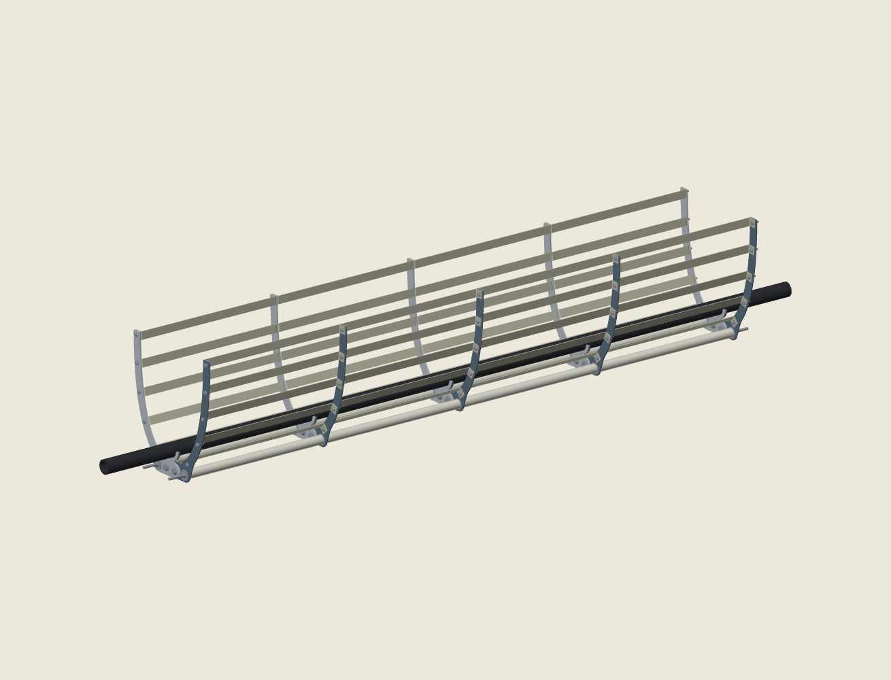
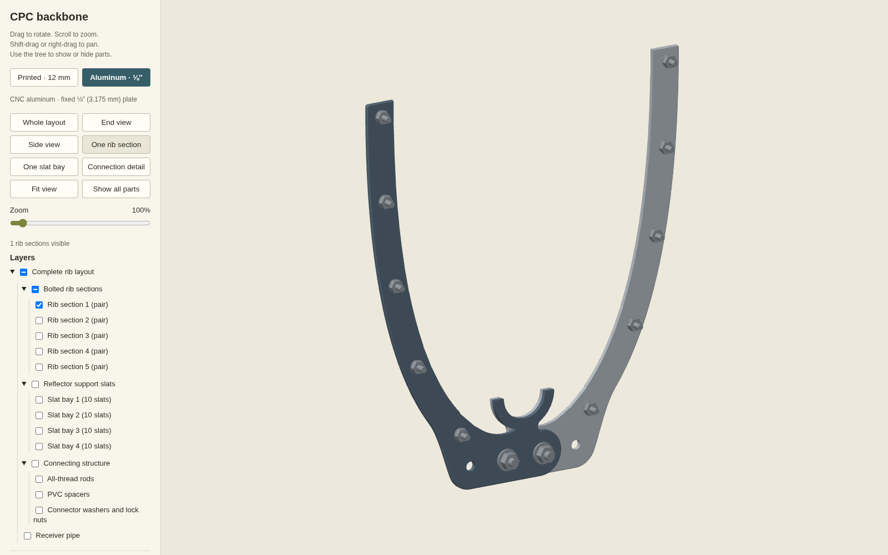
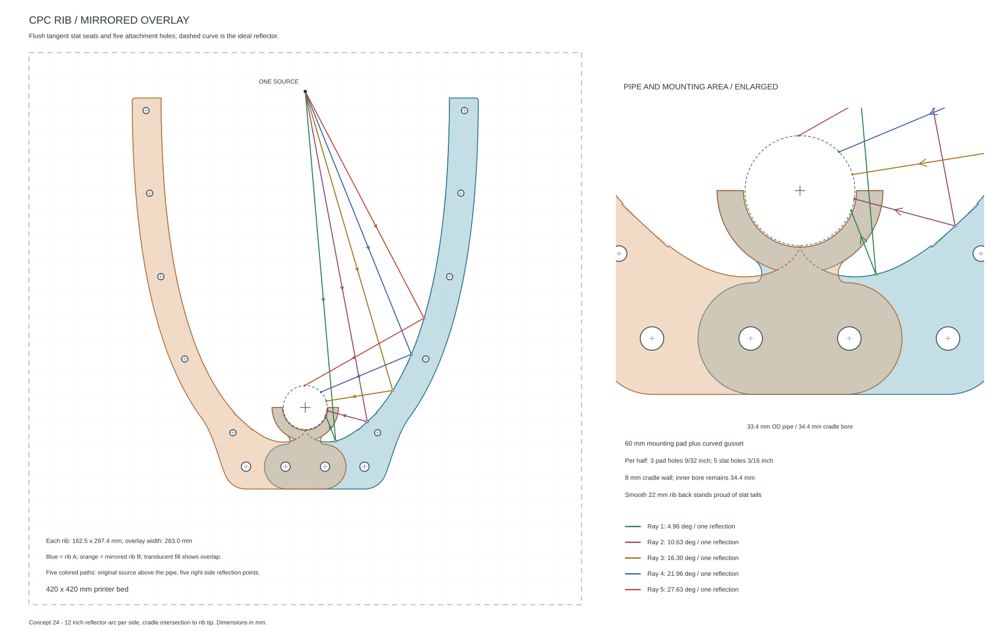

# CPC Solar Reflector Backbone

A modular backbone for a compound parabolic concentrator (CPC), with five
paired rib stations, one repeatable reflector-support slat, and a choice of
3D-printed prototype ribs or CNC-cut aluminum ribs.

## Inspiration and credit

This project was inspired by **NightHawkInLight** and his video
[DIY Solar Concentrators, Made Better.](https://www.youtube.com/watch?v=8zlAI32MSsQ)
See also [his companion project post](https://www.patreon.com/NightHawkProjects/posts/diy-solar-made-133833902).
His explanation of CPCs and string construction was the starting point for
exploring a repeatable rib-and-slat structure around a tubular receiver.
The CAD, dimensions, hardware choices and calculations presented here document
this project's implementation. Credit does not imply his review or endorsement.

## Current design

**v15 is a CAD design draft.** The geometry and exported models have been
checked; the assembly has not yet been physically built or tested. The printed
option is for fit prototyping. Aluminum is the intended later rib material.
Reflector material and attachment, receiver retention and external supports
remain to be designed.

[Open and rotate the model online](https://thatoneguydavid.github.io/Compound-Parabolic-Collector/assembly-viewer.html).

- Five stations, each made from two identical rib halves placed back-to-back
  in adjacent axial intervals, for ten halves total.
- Four bays, each carrying five support slats on each side: forty copies of
  one formed slat design.
- A 72″ receiver pipe, two 61″ all-thread rods and eight PVC spacer tubes.
- A 12″ reflector arc on each side, measured along the curve from the cradle
  intersection to the rib tip. This is a curved length, not the opening width.
- A nominal transverse acceptance half-angle of ±28.62976°, calculated from
  the chosen receiver and reflector arc.

### v15 update: rounded outer rib tips

The outer top corner now has a 2 mm radius to remove the sharp plan-view
point, especially for the CNC aluminum ribs. Both material options use the
same revised outline, including the DXF cutting files. The top slat tab still
fits inside the rib; the reflector curve, hole locations and master slat are
unchanged. Plate edges still need normal deburring during fabrication.

CAD, mesh, slat-clearance, DXF round-trip and browser checks pass. The main
image now shows only the model and links to the interactive online viewer.

[View the R2 outer-tip detail](images/tip-radius-detail.png).

## Printed and aluminum build options

| Dimension or hardware | Printed prototype | CNC aluminum |
| --- | ---: | ---: |
| Rib-half thickness | 12 mm | ⅛″ / 3.175 mm |
| Paired-section thickness | 24 mm | 6.35 mm |
| Station pitch | 375 mm | 366.175 mm |
| Rib layout span | 60″ / 1524 mm | 57.915″ / 1471.05 mm |
| Receiver overhang, each end | 6″ / 152.4 mm | 7.042″ / 178.875 mm |
| ¼″-20 rib-pair bolts | 1½″ long | ¾″ long |
| #8-32 slat screws | 1″ long | ⅝″ long |

The slats and PVC spacers keep the same length in both options. Thinner ribs
therefore shorten the aluminum assembly and leave more of the centered pipe
and rods exposed. Both options use the same transverse rib profile, with a 2 mm radius on the
outer top corner to remove the sharp tip. The
current half fits within an approximately 162.5 × 297.4 mm footprint.

## Interactive 3D preview

**[Open the interactive 3D viewer online](https://thatoneguydavid.github.io/Compound-Parabolic-Collector/assembly-viewer.html)**

The online viewer runs in a WebGL-capable browser with no download required.
You can also [download the self-contained HTML viewer](assembly-viewer.html)
for offline use. GitHub's repository file view displays HTML source; use the
online link above to open the running viewer.

Choose **Printed · 12 mm** or **Aluminum · ⅛″**. Switching materials updates
the rib thickness, station locations, fastener lengths, nested bill of
materials and model-download links. Rods, spacers and connector hardware have
independent visibility controls. Use **One rib section**, **One slat bay** or
**Connection detail** to inspect the joints. Online model downloads work
directly from the hosted viewer. For offline
model downloads, keep the repository folder alongside the HTML file; viewing
the assembly itself works from the single HTML file.

## Calculations, geometry and ray tracing

[Geometry and calculations](docs/GEOMETRY.md) documents the tubular CPC
equations, the 12″ arc constraint, receiver/cradle dimensions, station spacing,
spacer lengths, hole patterns and fastener stacks.

[Download the ray diagram as SVG](rib.svg) ·
[Ray coordinates and checks](docs/ray-trace.json)

The five rays share one nearby source and each make one reflection before
reaching the ideal circular receiver. This is a local geometry illustration.
It is not parallel sunlight, a whole-aperture acceptance test, or a measured
efficiency result. The ray model excludes mechanical shading, finite-length
end losses, surface errors and thermal behavior.

## Latest sketches and drawings

- [12″ cradle-to-tip arc definition](sketches/reflector-arc-02.png)
  ([SVG](sketches/reflector-arc-02.svg)).
- [Current reflector-support drawing 03](sketches/reflector-slats-03.png)
  ([SVG](sketches/reflector-slats-03.svg)), generated from the v15 slat geometry.
- [Earlier reflector-support concept, sketch 02](sketches/reflector-slats-02.png)
  ([SVG](sketches/reflector-slats-02.svg)). This sketch records the support
  arrangement before the final 12″ arc revision; use the v15 CAD and current
  arc drawing for final geometry.
- [Aluminum slat-bay rendering](images/aluminum-slat-bay-preview.png) and
  [printed slat-bay rendering](images/printed-slat-bay-preview.png).

## Bill of materials

Quantities below cover one complete five-station CAD backbone. This is the
full modeled assembly BOM; unfinished items needed for a working collector
are listed separately below. Lengths of bolts and screws are under the head.
Confirm actual washer/nut dimensions before buying hardware or cutting spacers.

| Part | Quantity | Printed option | Aluminum option |
| --- | ---: | --- | --- |
| Identical rib half | 10 | Printed, 12 mm thick | CNC aluminum, ⅛″ thick |
| Receiver pipe | 1 | 72″ long, 33.401 mm OD | Same |
| Identical formed support slat | 40 | ¾″ × 1/16″ strip; 363 mm formed span | Same |
| Rib-pair hex bolt | 10 | ¼″-20 × 1½″ | ¼″-20 × ¾″ |
| Rib-pair hex nut | 10 | ¼″-20 | Same |
| Rib-pair flat washer | 20 | ¼″ bore clearance, ⅝″ OD, modeled 1/16″ thick | Same |
| Slat pan-head screw | 50 | #8-32 × 1″ | #8-32 × ⅝″ |
| Slat hex nut | 50 | #8-32, modeled 0.130″ high | Same |
| Slat flat washer | 100 | #8, ⅜″ OD, modeled 0.032″ thick | Same |
| All-thread rod | 2 | ¼″-20 × 61″ | Same |
| PVC spacer tube | 8 | ½″ nominal Schedule 40; cut length 359.825 mm | Same |
| Fender washer | 20 | ¼″ bore clearance, 1″ OD, modeled 1/16″ thick | Same |
| Nylon-insert end lock nut | 4 | ¼″-20 | Same |

[Download the BOM as CSV](docs/bill-of-materials.csv).

Interior stations share slat through-fasteners between adjacent bays. This
accounts for fifty slat screws across eighty slat ends. Slat stock blank length
is still to be determined by bend allowance and a formed sample; 363 mm is the
formed axial span. The receiver's 26.6 mm modeled ID is illustrative, not a
confirmed pipe specification.

The working collector still needs reflector sheet/film and its attachment,
receiver retention, external supports/tilt adjustment, and application-specific
receiver connections. Their specifications and quantities remain open. Printed
material, print settings, aluminum alloy and fabrication tolerances are also
to be selected. This BOM does not yet define a complete operational collector.

## STL, DXF and CAD downloads

| File | Printed | Aluminum |
| --- | --- | --- |
| Rib-half STL | [STL](models/v15/printed/rib-half.stl) | [STL](models/v15/aluminum/rib-half.stl) |
| Rib-half nominal cutting profile | [DXF](models/v15/printed/rib-half.dxf) | [DXF](models/v15/aluminum/rib-half.dxf) |
| Rib-half editable CAD | [STEP](models/v15/printed/rib-half.step) | [STEP](models/v15/aluminum/rib-half.step) |
| Bolted rib section | [STEP](models/v15/printed/rib-section.step) | [STEP](models/v15/aluminum/rib-section.step) |
| Single master slat | [STEP](models/v15/printed/reflector-slat.step) / [STL](models/v15/printed/reflector-slat.stl) | [STEP](models/v15/aluminum/reflector-slat.step) / [STL](models/v15/aluminum/reflector-slat.stl) |
| Ten-slat bay | [STEP](models/v15/printed/slat-bay.step) | [STEP](models/v15/aluminum/slat-bay.step) |
| Complete backbone | [STEP](models/v15/printed/backbone.step) / [GLB](models/v15/printed/backbone.glb) | [STEP](models/v15/aluminum/backbone.step) / [GLB](models/v15/aluminum/backbone.glb) |

The slat STL is a shape reference for the formed metal strip. DXFs are 1:1
millimeters with nine closed contours: one outer profile and eight holes.
They are extracted at the STEP rib's mid-thickness to retain the nominal
outline beneath cosmetic face edge rounding. DXF curves include splines;
confirm CAM support. Tool/kerf compensation and edge finishing are not included.

## Source and validation

[Reproduction instructions](docs/REPRODUCING.md) describe the Python generators
and checks included here. The design uses build123d for CAD and a self-contained
WebGL viewer. Current reports accompany the models under `models/v15/`:

- Per-option CAD/mesh, hardware and independent slat/joint validation reports.
- [Export checks](models/v15/export-validation.json).
- [DXF round-trip checks](models/v15/dxf-validation.json).
- [Browser checks](models/v15/viewer-validation.json).

These checks establish modeled dimensions, geometry and viewer behavior.
Physical fit, forming accuracy, thermal behavior and structural performance
remain untested. Further work includes one formed slat, one assembled rib
pair, and a short connected backbone sample before a full collector build.
