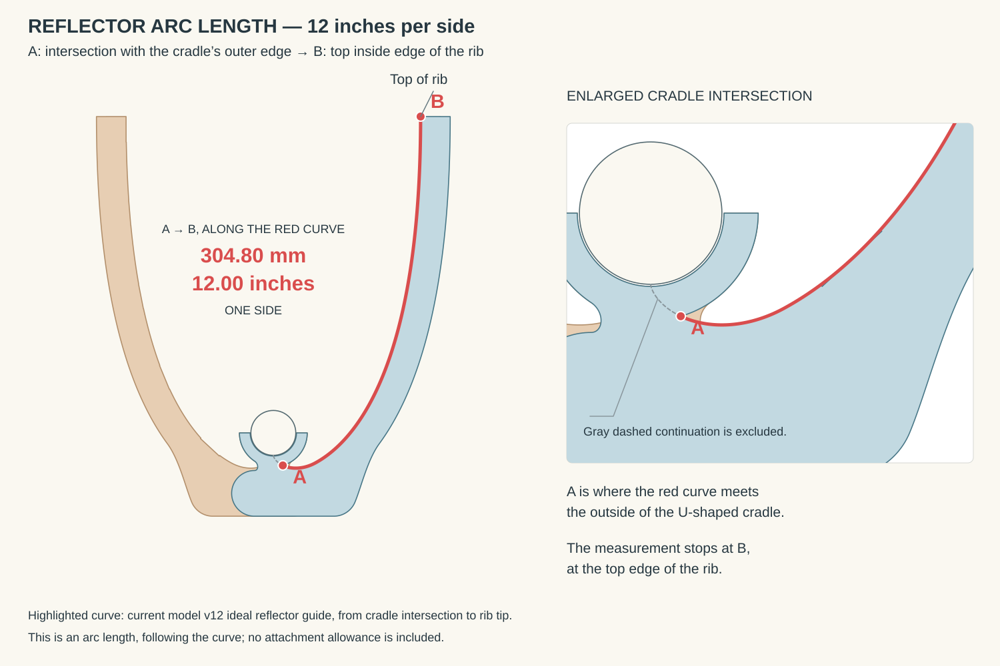

# Geometry and calculations — v15

All dimensions below are millimeters unless marked otherwise. Angles in the
equations are radians. Source code: [profile_geometry.py](../src/profile_geometry.py),
[slat_geometry.py](../src/slat_geometry.py), and
[hardware_geometry.py](../src/hardware_geometry.py).

## Tubular CPC profile

The receiver center is `(0, 0)`. Positive `y` points toward the opening;
positive `x` points toward the right reflector. Receiver radius
`r = 33.401 / 2 = 16.7005`. Let `a` be the acceptance half-angle and `t` the
curve parameter. The right-hand optical profile is:

```text
rho(t) = r*t                                      0 <= t <= pi/2 + a
rho(t) = r*(t+a+pi/2-cos(t-a))/(1+sin(t-a))         pi/2+a <= t <= 3*pi/2-a

x(t) = r*sin(t) - rho(t)*cos(t)
y(t) = -r*cos(t) - rho(t)*sin(t)
```

The left reflector is `(-x(t), y(t))`. The first branch is an involute of the
circular receiver; the second is the upper tubular CPC branch. The mechanical
cradle and mounting pad are additions to this optical construction.

The equations are documented in [Wang, Wang and Tang (2016), equations 1–2](https://www.mdpi.com/1996-1073/9/10/795)
and [Casano, Fossa and Piva (2017), equation 1](https://iieta.org/journals/ijht/paper/10.18280/ijht.35Sp0125).
Those papers concern their own collectors; their performance results are not
measurements of this backbone.

## Solving the 12-inch arc constraint

The cradle bore radius is `r + 0.5 = 17.2005`. Its 8 mm wall gives an outer
collar radius `Rc = 25.2005`. The reflector intersects that outer collar at:

```text
tA = sqrt((Rc/r)^2 - 1) = 1.1300357497
t0 = pi/2 + a
tB = 3*pi/2 - a
```

The specified 12″ / 304.8 mm arc is measured from A at `tA` to the tip B at
`tB`. It excludes the ideal lower reflector between the receiver cusp and A.
For the involute, speed is `r*t`; for the upper branch it is
`rho(t)*sqrt(2/(1+sin(t-a)))`. Thus:

```text
S(a) = r/2 * (t0^2 - tA^2)
       + integral[t0..tB] rho(t)*sqrt(2/(1+sin(t-a))) dt

Solve S(a) = 304.8 mm
```

The generator uses 2,000-interval Simpson integration for the upper branch
and 44 bisection iterations over 5°–85°. The solution is
`a = 28.6297600599°`, so the nominal total transverse acceptance is about
57.25952°. An independent 100,000-segment length calculation checks the arc
against 304.8 mm to within 0.001 mm.

At this solution, A is approximately `(7.0530, -24.1934)` and B is
`(109.4989, 235.4418)`. The ideal opening width is `2*x(B) = 218.9978 mm`.
The 12″ value is neither this width nor the straight A–B distance.



## Ray-trace method and limits

The [current drawing](../rib.png) uses the complete ideal optical skin from
`t=0` through `tB`, sampled with 6,000 segments per side. The source is fixed
at `(0, y(B)+5)`. Five directions are chosen between the low reference ray
and `a-1°`. Each ray must hit the right reflector before the receiver, reflect
once, then hit the receiver before any second wall intersection.

For normalized incident direction `d` and a unit normal `n` from the hit
segment's tangent:

```text
reflected = d - 2*(d dot n)*n
receiver intersection: |hit + distance*reflected|^2 = r^2
```

The trace solves ray/segment intersections, takes the nearest valid hit,
solves the receiver-circle quadratic, and checks for an intervening reflector.
It verifies five distinct reflection points, one common source, unit reflected
directions and receiver endpoints within 1e-6 mm radial error. Exact ray
coordinates, input angles and checks are in [ray-trace.json](ray-trace.json).

This finite-source fan is an illustrative diagnostic, not sunlight from five
simultaneous solar positions. It does not prove full-aperture acceptance or
collector efficiency. The lower ideal reflector around the receiver is part
of the trace, while the rib/cradle are projected mechanical outlines. Material
selection and construction of that lower reflector remain open. Mechanical
shadows, imperfect reflectance, end losses and heat transfer are excluded.
Historical ray tests on earlier profiles are not claimed as validation of
the current acceptance range.

## Ribs and slats

Each section contains two identical halves in adjacent axial intervals:
`[z, z+h]` and `[z+h, z+2h]`. The left half is the same part rotated into
place. The outside top corner has a 2 mm in-plane radius, included in the CNC DXF.
It rounds the junction of the top edge and outer back while retaining the
reflector curve and top slat seat. The curved rib web is 22 mm; nominal outer edge rounding is 0.8 mm.
The slat bend/tail projections fit within the rib with a conservative minimum
back margin of approximately 0.150 mm at the rounded top corner and at least 1.961 mm
at the other rows after accounting for that rounding.

Each half has three 9/32″ / 7.14375 mm structural holes at
`(-15,-45)`, `(15,-45)` and `(45,-45)`. The paired inner holes clamp the ribs;
the mirrored outer holes take the two all-thread rods. Five additional
3/16″ / 4.7625 mm holes attach the slats. Their coordinates and local tangent
directions are listed in each option's `slats.json`.

The master slat is 19.05 mm wide and 1.5875 mm thick, with 1.5875 mm inner
bend radii, 19.05 mm tab depth and rounded 90° end bends. Hole centers lie
11.5 mm down the tabs. The formed axial span is 363 mm. The bottom support
is located 45 mm along the reflector arc from A; upper stations follow the
remaining interval, with the top support edge ending at B. All forty slats
are rigid placements of one master; there are no row-specific slat designs.
The flat blank length requires a bend allowance and a physical sample.

## Longitudinal spacing

For rib thickness `h`, five stations and a fixed formed slat span of 363 mm:

```text
station pitch P = 363 + h
rib span L = 4*P + 2*h
receiver pipe length = 72*25.4 = 1828.8
pipe overhang at each end = (1828.8 - L)/2
PVC spacer length = P - h - 2*(25.4/16) = 359.825
all-thread length = 61*25.4 = 1549.4
```

| Result | Printed h=12 | Aluminum h=3.175 |
| --- | ---: | ---: |
| P | 375 | 366.175 |
| L | 1524 | 1471.05 |
| Pipe overhang per end | 152.4 | 178.875 |
| PVC spacer length | 359.825 | 359.825 |

The rod rows are axially staggered by one rib thickness to bear on their
respective halves. Flat washers and lock nuts capture the rod ends. Washer
thickness directly affects spacer cut length; measure actual hardware first.

## Fastener stacks

Pair-bolt stack = `2*h + 2*1.5875 + 5.55625` including both ribs, both
washers and the nut. Slat-screw stack = `h + tab_count*1.5875 + 2*0.8128 + 3.302`,
where tab count is one at end stations and two at interior stations.

| Joint | Printed protrusion beyond nut | Aluminum protrusion beyond nut |
| --- | ---: | ---: |
| Rib pair | 5.36875 mm | 3.96875 mm |
| Slat, end station | 6.8849 mm | 6.1849 mm |
| Slat, interior station | 5.2974 mm | 4.5974 mm |

The modeled ¼″-20 pitch is 1.27 mm and #8-32 pitch is 0.79375 mm. All selected
fasteners pass the full modeled washer/nut stack with at least two pitches
beyond the nut. Threads are represented as nominal cylinders, not helices;
actual thread runout, hardware tolerances and purchased dimensions need
confirmation before fabrication.
